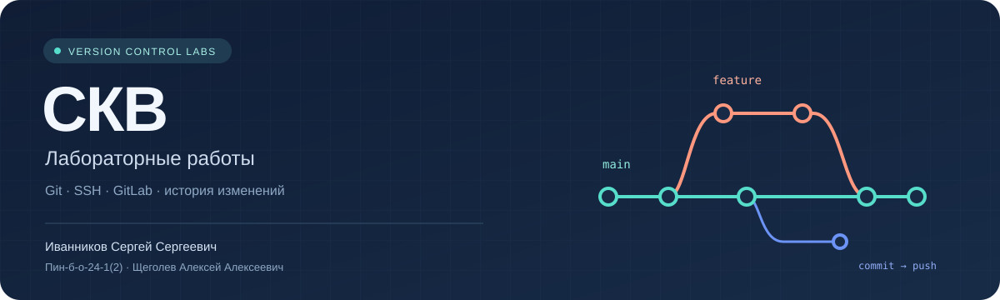

<p align="center"></p>

<p align="center"><a href="#roadmap">Карта курса</a> · <a href="#labs">Лабораторные</a> · <a href="#passport">Паспорт курса</a> · <a href="#workflow">Как устроен сборник</a> · <a href="docs/CONTEXT.md">Точка продолжения</a> · <a href="#conclusion">Общее заключение</a></p>

# СКВ · Практика, история, результат

Системы управления/контроля версиями. Единый сборник: практика и история операций в GitLab, оформленные отчёты на GitHub.

| Опубликованные отчёты | Слитые MR работ №2–4 | Вопросы работ №1–4 |
|:---:|:---:|:---:|
| 04 | 06 | 37 |

Основание показателей: четыре Markdown-отчёта, по два слитых MR работ №2–4, вопросы — 8 + 9 + 10 + 10. Это не оценки преподавателя.

<a id="roadmap"></a>
## СКВ · Карта курса

| № | Методичка | Статус | Переход |
|:---:|---|---|---|
| 01 | 0102_lab.md | Отчёт опубликован | [Читать](labs/lab01/README.md) |
| 02 | 0202_lab.md | Отчёт опубликован | [Читать](labs/lab02/README.md) · [граф](docs/branch-graphs.md#скв--лабораторная-2) |
| 03 | 0302_lab.md | Отчёт опубликован | [Читать](labs/lab03/README.md) · [граф](docs/branch-graphs.md#скв--лабораторная-3) |
| 04 | 0402_lab.md | Отчёт опубликован | [Читать](labs/lab04/README.md) |
| 05 | 0502_lab.md | Впереди | — |
| 06 | 0602_lab.md | Впереди | — |
| 07 | 0702_lab.md | Впереди | — |
| 08 | 0802_lab.md | Впереди | — |
| 09 | 0902_lab.md | Впереди | — |
| 10 | 1002_lab.md | Впереди | — |

Темы следующих работ определяются по конкретным методичкам, не по расходящемуся с ними тематическому плану.

<a id="labs"></a>
## СКВ · Лабораторные работы

### 01 / Git, SSH и GitLab

[Отчёт №1](labs/lab01/README.md) · [Практический GitLab](https://gitlab.com/akkariq/lab1-pin-b-o-24-1-2-ivannikovss)

<details><summary>Результаты и границы проверки №1</summary>

Git 2.47.3, автор, SSH, README.md и .gitignore проверены. Коммиты: 8052a3a, c1f4071, e9986a8; восемь ответов. Точная ОС, отдельные журналы установки Git, генерации ключа и ssh-agent не подтверждены.

</details>

### 02 / Ветки, merge и rebase

[Отчёт №2](labs/lab02/README.md) · [Граф](docs/branch-graphs.md#скв--лабораторная-2) · [MR !1](https://gitlab.com/akkariq/lab1-pin-b-o-24-1-2-ivannikovss/-/merge_requests/1) · [MR !2](https://gitlab.com/akkariq/lab1-pin-b-o-24-1-2-ivannikovss/-/merge_requests/2)

<details><summary>Результаты и оговорки №2</summary>

Merge, два rebase, конфликты, revert, fast-forward; два MR без squash, семь серверных веток. Main и release/lab2-final — 440b925, девять ответов. Оговорки: revert вместо неоднозначного reset HEAD~3, release/lab2-final вместо release; diff.txt и history.txt — снимки.

</details>

### 03 / Fork, Merge Request и upstream

[Отчёт №3](labs/lab03/README.md) · [Граф](docs/branch-graphs.md#скв--лабораторная-3) · [Источник](https://gitlab.com/akkariq/collab-project) · [Форк](https://gitlab.com/ivannikov-skv/collab-project) · [MR !1](https://gitlab.com/akkariq/collab-project/-/merge_requests/1) · [MR !2](https://gitlab.com/akkariq/collab-project/-/merge_requests/2)

<details><summary>Результаты и оговорки №3</summary>

Origin и upstream, два MR из форка, синхронизация на e5e4b45; защита main: merge — Maintainers, push — No one. Десять ответов. Внешнее Code Review не выполнено: обе роли исполнял один студент. Ошибочный MR форка закрыт без слияния, history.txt остаётся локальным.

</details>

### 04 / Отмена изменений и управление историей

[Отчёт №4](labs/lab04/README.md) · [GitLab](https://gitlab.com/akkariq/lab4-history) · [MR !1](https://gitlab.com/akkariq/lab4-history/-/merge_requests/1) · [MR !2](https://gitlab.com/akkariq/lab4-history/-/merge_requests/2)

<details><summary>Результаты и оговорки №4</summary>

Reset (soft, mixed, hard), revert, restore, amend, reword, squash, drop, edit; non-fast-forward и два force-with-lease. Учебный secret.txt удалён из достижимой истории до отправки, резервные ссылки локально не очищались. Два MR без squash, main — 0148d19, четыре серверные ветки, десять ответов. Поздняя практика feature/experiment осталась локальной; file3.txt — untracked. Восстановление через reflog — теория.

</details>

Успешный CI/CD работ №2–4 и оценка преподавателя всех работ не заявляются. Подробные ограничения сохранены в отчётах.

<a id="passport"></a>
## СКВ · Паспорт курса

| Поле | Значение |
|---|---|
| Дисциплина | Системы управления/контроля версиями |
| Студент | Иванников Сергей Сергеевич |
| Группа | Пин-б-о-24-1(2) |
| Преподаватель | Щеголев Алексей Алексеевич |

<a id="workflow"></a>
## СКВ · Как устроен сборник

GitLab хранит учебные проекты, ветки, коммиты и MR. GitHub содержит паспорта, ход выполнения, команды, результаты, оговорки и контрольные вопросы.

```
version-control-labs/
├── README.md
├── AGENTS.md
├── assets/course-cover.svg
├── docs/
│   ├── CONTEXT.md
│   └── branch-graphs.md
└── labs/
    ├── lab01/README.md
    ├── lab02/README.md
    ├── lab03/README.md
    └── lab04/README.md
```

[Точка продолжения](docs/CONTEXT.md) · [Указатель](AGENTS.md) · [Графы №2–3](docs/branch-graphs.md).

<details><summary>Принципы публикации</summary>

Сначала практика и проверка по методичке, затем оформление и согласованная публикация. Не выдумываем доказательства и не публикуем реальные секреты. Word-версии №1–4 выданы отдельно, на GitHub не загружаются; доступность старых вложений не гарантируется. Сборник содержит только Markdown-отчёты.

</details>

<a id="conclusion"></a>
## СКВ · Общее заключение

Работы №1–4 охватывают Git и SSH, ветвление и конфликты, fork/upstream, защиту main и редактирование истории. Проверены шесть слитых MR работ №2–4. Отсутствие внешнего ревью №3 и ограничения очистки истории №4 описаны явно. Следующий этап — чтение 0502_lab.md; итог курса будет дополнен после остальных работ.

<p align="center"><sub>Иванников Сергей Сергеевич · Пин-б-о-24-1(2) · СКВ</sub></p>
