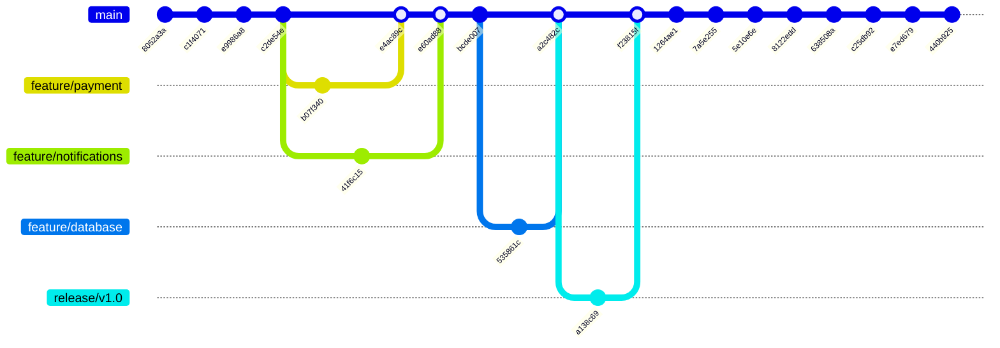
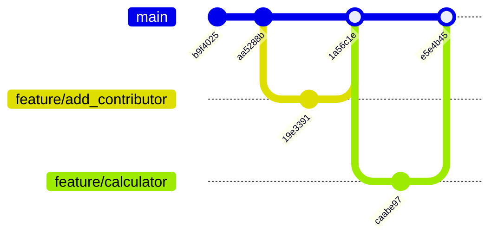

# СКВ · Графы ветвления

[← К сборнику](../README.md) · [Отчёт №2](../labs/lab02/README.md) · [Отчёт №3](../labs/lab03/README.md)

Схемы построены вручную по подтверждённым хешам из отчётов. Они показывают упрощённую логику истории, а не точный вывод `git log`: порядок и расположение коммитов приближённые, ветки с названием из примера Mermaid не заменяют реальный граф на GitLab.

## СКВ · Лабораторная №2

Ветки оплаты и уведомлений слиты в main, затем ветка базы данных (в состоянии после rebase поверх `bcde007`) слита через MR !1, а релизная ветка — через MR !2. Дальше на main выполнены учебные фичи, два revert, исправление и fast-forward третьей фичи.

Коммит `dbc966c` до rebase и `ef57499` до второго rebase в схему не включены: они заменены `535861c` и `e7ed679`. Ветка `release/lab2-final` указывает на `440b925`.

## СКВ · Лабораторная №3

История основной ветки исходного проекта `akkariq/collab-project`. Feature-ветки лежали в форке `ivannikov-skv/collab-project` и вливались в источник через два Merge Request; Code Review другим человеком не выполнялся.

| Этап | Где происходит | Результат |
|---|---|---|
| Fork | GitLab, группа ivannikov-skv | Форк ID 87614914 |
| Ветка и push | Форк, origin | `19e3391`, затем `caabe97` |
| MR !1 и !2 | Из форка в `main` источника | Merge-коммиты `1a56c1e` и `e5e4b45` |
| Синхронизация | `fetch upstream`, `merge --ff-only`, `push origin main` | Источник и форк на `e5e4b45` |
